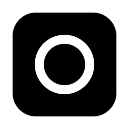

<p align="center">
  <a href="https://mogbot.app"></a>
</p>

<h1 align="center">Mogbot</h1>

<p align="center"><b>The bot that makes your other bots look bad.</b></p>

<p align="center">
  A team of AI agents on your own computer, running on the Claude and ChatGPT plans you already pay for.<br>
  Free and open source. Built for every computer: Mac, Windows and Linux, with a phone app for iPhone (Android coming).
</p>

<p align="center">
  <a href="https://mogbot.app/start"><b>Download</b></a> ·
  <a href="https://mogbot.app">Website</a> ·
  <a href="https://mogbot.app/changelog">Changelog</a> ·
  <a href="docs/INSTALL.md">Build from source</a> ·
  <a href="https://mogbot.app/llms.txt">For AI agents</a>
</p>

<p align="center">
  <a href="https://github.com/native-io-team/mogbot-releases/releases/latest"></a>
  <a href="LICENSE"></a>
  
</p>

<p align="center">
  <picture>
    <source media="(prefers-color-scheme: dark)" srcset="docs/images/readme/agents-dark.webp">
    
  </picture>
</p>

You talk to a **Chief of Staff**. It makes an agent for each job you hand it,
briefs it, and comes back with the result. Every agent has its own
instructions, memory, routines and model, and works on your computer with your
apps and your files. Anything that spends money, uses your passwords or deletes
for good waits for your **Allow**, on the desk or on your phone.

## Why Mogbot

**Higher limits.** Add every Claude and ChatGPT plan you have: personal, work,
a client's. When one runs out, your agents carry on with the next. The app
shows your limits only as the engine reports them, and what each agent used.

**Better models.** Pick the engine and model for each agent: Claude Code
(Opus or Sonnet), Codex (GPT), or OpenCode with open models like Kimi, DeepSeek
or Qwen, from a provider or on your own machine.

**Real work.** Every project gets its own workspace: the agent's chat,
terminals, the live site and a visual editor, side by side. Agents work on
their own branch, so you keep, review or throw away what they did.

**One app for everything.** Agents get in through your apps (Gmail, Calendar,
Slack, GitHub, Figma and more), the tools on your computer, their own browser
or your signed-in Chrome when you allow it.

**You decide how much they do alone.** One slider per team or per agent:
Careful, Steady, Bold, Unleashed. Even at Unleashed they stop for money,
passwords, deleting for good and going live.

**On your phone.** Pair by QR code. Chat, approve from the Lock Screen, review
results and start routines from anywhere.

<p align="center">
  <picture>
    <source media="(prefers-color-scheme: dark)" srcset="docs/images/readme/projects-dark.webp">
    
  </picture>
</p>

## Download

| | Get it | Notes |
|---|---|---|
| **Mac** | [Mogbot.dmg](https://github.com/native-io-team/mogbot-releases/releases/latest/download/Mogbot.dmg) | Apple silicon, macOS 14 or later. Signed, notarized, updates itself |
| **Windows** | [Installer (.exe)](https://github.com/native-io-team/mogbot-releases/releases/latest/download/Mogbot-windows-x86_64-setup.exe) · [.msi](https://github.com/native-io-team/mogbot-releases/releases/latest/download/Mogbot-windows-x86_64.msi) | 64-bit (x64), signed and ready. No auto-update yet |
| **Linux** (early beta) | [All builds](https://github.com/native-io-team/mogbot-releases/releases/latest) | AppImage, .deb and .rpm for x86_64 and arm64. Less tested. No auto-update yet |
| **iPhone** | [TestFlight beta](https://mogbot.app/phone) | Public beta |
| **Android** | Coming soon | In testing |

Mac 1.0.8 is the full release. Windows 1.0.8 is signed and ready. Linux is an early beta. On Windows and Linux, pairing your phone, app sign-ins and connecting your other assistants are still coming.

Or go to **[mogbot.app/start](https://mogbot.app/start)**, which picks the right one for your device.

**What you need:** a computer that's on while your agents work, and a Claude
plan (Pro or Max) or a ChatGPT plan (Plus or Pro). Or OpenCode with any
provider, no plan needed. Setup takes about five minutes: pick an engine, the
app installs and signs it in, and you're in a chat with your Chief of Staff.

Already using another assistant? Bring your agents over: connect it (Claude,
ChatGPT, Grok…) and it hands them over in a conversation (on Mac today),
drop in an export from Grok Bot, OpenBot, OpenClaw or Hermes, or paste back one
reply from any assistant. You review it all on one card before anything is
imported. Ship Studio's agents copy straight in.

## How it compares

- **Grok Bot, Muse and other consumer agents** are easy to start and run in
  their company's cloud, on one usage pool and the models they pick. Mogbot
  runs on every plan you pay for, any model, on a computer you choose.
  Side by side: [vs Grok Bot](https://mogbot.app/vs/grok-bot),
  [vs Muse](https://mogbot.app/vs/muse).
- **Claude Code or Codex in a terminal:** the same engines, plus a team with
  memory, approval and result cards, routines, usage across accounts, project
  workspaces and a phone app. You can still drop into any agent's terminal.
- **The trade-off:** your computer does the work, so it has to be on while
  your agents run.

## Privacy and what we host

The app is MIT licensed and free, with no account needed. Your agents, chats
and files stay on your computer; they talk to the AI providers you pick, under
your own plans. Native hosts only what needs a server, and each has a way
around it:

- **Phone relay:** an optional free sign-in lets your phone reach your
  computer from anywhere, end to end encrypted. Or use your own Tailscale.
- **Push notifications:** sent through our push relay to the official iPhone
  app (not Android yet), as a generic alert with no message, agent name or
  project. On by default; turn off **Phone notifications** in Settings → Phone.
- **Error reports:** crashes and errors are sent scrubbed of personal paths,
  on by default. Turn them off in Settings → Advanced → **Usage analytics &
  error reports** (despite the name, the app sends no usage analytics), and on
  the phone in Settings → Error reports.

Details: [mogbot.app/privacy](https://mogbot.app/privacy),
[docs/OPEN-AND-HOSTED.md](docs/OPEN-AND-HOSTED.md),
[mogbot.app/free](https://mogbot.app/free).

## Build from source

The full runbook, with a check for every step, is
**[docs/INSTALL.md](docs/INSTALL.md)**. The easiest way: open this folder in
Claude Code or Codex and say:

> Set this up on my Mac and phone. Follow docs/INSTALL.md.

It installs the tools, builds the app and stops only for what needs you.

By hand: you need Node 22+, pnpm 9 and Rust (plus Xcode Command Line Tools on a
Mac). [INSTALL.md](docs/INSTALL.md) walks through the Mac today. Windows and
Linux builds come from CI ([build-installers.yml](.github/workflows/build-installers.yml)),
and their step-by-step guides are coming.

```bash
git clone https://github.com/native-io-team/mogbot.git && cd mogbot
pnpm install
pnpm tauri:dev        # run from source with hot reload
```

`pnpm dev` alone runs only the web UI, without the desktop app.

**The phone app from source** comes two ways (or use TestFlight): **Expo Go**
(minutes; no dictation or share sheet) or **built with Xcode** (the real app;
with a free Apple ID, re-install every 7 days). Self-built phone apps don't get
push notifications. See [INSTALL.md, step 13](docs/INSTALL.md#step-13-choose-how-to-get-the-phone-app).

Your computer does the work, so agents stop when it sleeps or the app is
closed. The app tells you what will and won't keep running.

## Something broken?

Tell your Chief of Staff in your own words. It writes the problem up, shows
you exactly what will be sent, and sends it on your OK; an agent of ours
checks it against the code and files or links the GitHub issue. Or
[open an issue](https://github.com/native-io-team/mogbot/issues) yourself.

## Security

Agents run with edits allowed and everything else routed through an approval
broker: what they may do on their own is set by the independence level, and a
short floor (money, credentials, deleting for good, pushing to production)
always asks. Tokens and secrets live only in the macOS Keychain, never in the
chat, argv or logs. Text from outside (web pages, mail, other people's
messages) can't raise what an agent may do: imports and "When…" checks run
sealed, read-only calls. The phone pairs only to a computer that proves its
pinned identity, and every pairing is confirmed on the desk. Details:
[docs/agents.md](docs/agents.md#approvals), [docs/mobile.md](docs/mobile.md).
To report a vulnerability, see [SECURITY.md](SECURITY.md).

## Status

Early, and moving fast: a release most days. Mogbot is built for every
computer. Mac 1.0.8 is the full release, Windows 1.0.8 is signed and ready,
and Linux is an early beta. On Windows and Linux, pairing your phone, app sign-ins and connecting your other assistants are still coming. The iPhone app is on TestFlight, and Android
is in testing. What's next: [docs/ROADMAP.md](docs/ROADMAP.md).

## Docs

- [docs/guide](docs/guide): how to use Mogbot
- [docs/INSTALL.md](docs/INSTALL.md): setup runbook, for you or your agent
- [docs/agents.md](docs/agents.md): agents, approvals, routines, memory, engines
- [docs/mobile.md](docs/mobile.md): the phone app and pairing
- [docs/remote-access.md](docs/remote-access.md): driving your agents from another assistant
- [docs/MISSION.md](docs/MISSION.md) and [docs/ROADMAP.md](docs/ROADMAP.md): why it exists and what's next
- [docs/FORKING.md](docs/FORKING.md): the app's name lives in [`brand.json`](brand.json), so a fork renames it in one place

## Contributing

Contributions are welcome. Start with [CONTRIBUTING.md](CONTRIBUTING.md):
setup, the UI harness, tests and the patterns the codebase expects.
[AGENTS.md](AGENTS.md) and [CLAUDE.md](CLAUDE.md) are the architecture
reference for people and coding agents alike. Please read the
[Code of Conduct](CODE_OF_CONDUCT.md).

## Made by Native

Mogbot is made and funded by [Native](https://www.native.agency), and grew
out of [Ship Studio](https://ship.studio). It opens Ship Studio projects
(`~/ShipStudio`, the in-project `.shipstudio/` folder) and vice versa, runs
beside it, and can copy Ship Studio's agents in.

[MIT](LICENSE) © Julian Galluzzo, Native, and contributors.
