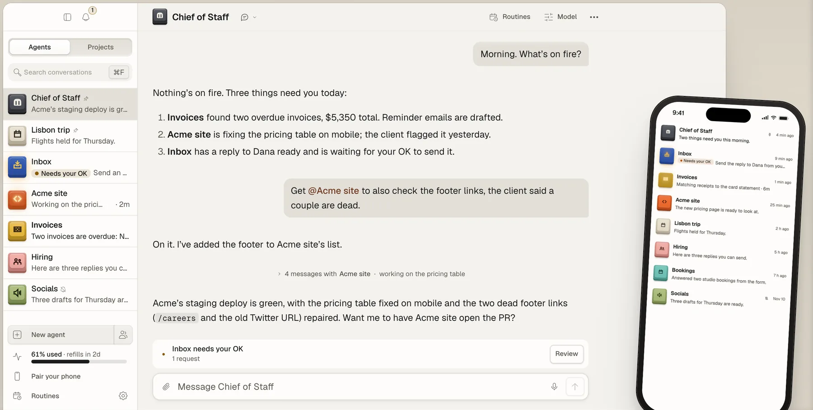
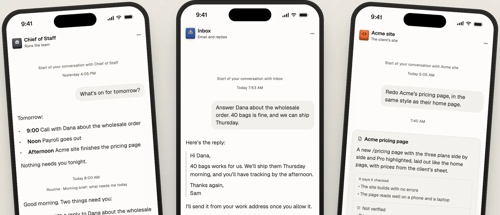
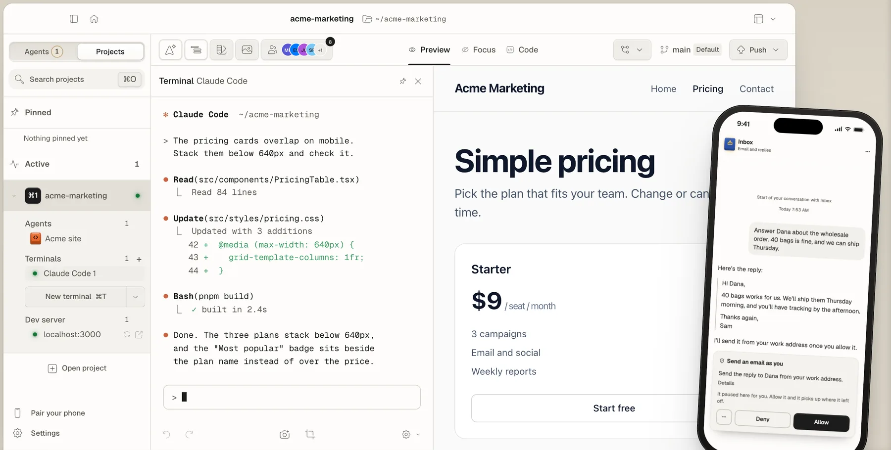
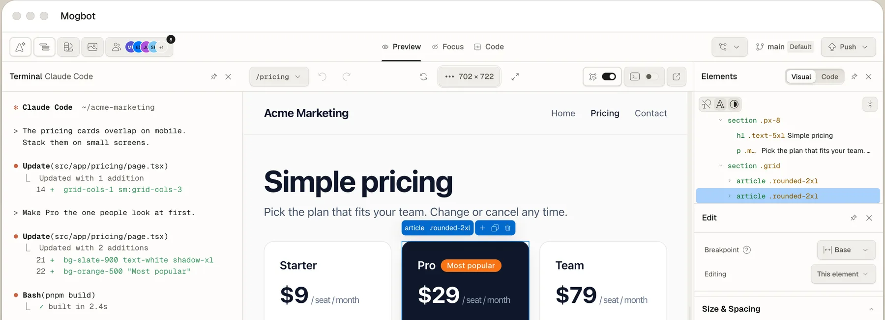

# Mogbot

**The bot that makes your other bots look bad.**

Mogbot runs your Claude and ChatGPT plans as a team of agents, on your
computer and your phone. Free and open source (MIT). Mac now, Windows and
Linux soon, with apps for iPhone and Android.

<p align="center">
  <picture>
    <source media="(prefers-color-scheme: dark)" srcset="docs/images/readme/agents-dark.webp">
    
  </picture>
</p>

You talk to a **Chief of Staff**. It creates named agents for the work you hand
it, briefs them, delegates, and comes back with results. Each agent remembers
you, keeps its own instructions and routines, and runs on **Claude Code,
Codex or OpenCode** (your pick, per agent) on your own machine. Anything that spends money,
sends something as you, or changes what other people see waits for your
**Allow**. Follow along and answer from your phone.

The app's name lives in one file, [`brand.json`](brand.json), so a fork can
rename it in one place.

## What it does

### A team you can see

Every agent is a key: its own colour, an icon, and a letter on your keyboard
that jumps straight to it. A key is pressed while the agent works, sits proud
and lit when it needs your OK, and comes out of its socket when it's paused.
The Chief makes new ones from one sentence; you review them once, then they
exist. Agents can work together in rooms, and you can step into any agent's
own session in a terminal and hand it back.

### Work comes back checked

Finished work is one card: the files and links, what the agent **says** it
checked, and what it **didn't** verify. Ask for changes and you get a new
version. Under every reply, a folded "what it did" timeline shows the steps it
actually took. An agent working on a project gets its own copy (a git
worktree on its own branch), so you choose Keep changes, Review, Preview or
Discard.

### Usage you can trust

The app shows your plan's limits only as the engine reports them, and what
each agent and routine used this week. Nothing is guessed; an estimate is
labelled as one. Add more than one account and agents carry on with the next
when one runs out, or with the other engine if you say so. Pick Normal, Save
my limits, or Use it all before the refill.

### You decide how much they do alone

One slider per team or per agent: **Careful, Steady, Bold, Unleashed**. Each
step lets agents do more without asking. Even at Unleashed they stop for
money, logins, deleting for good and going live. Approvals arrive as an Allow /
Deny card. Secrets go into a masked card and the macOS Keychain, never the
chat. Logins use the provider's own sign-in; agents never ask for a password.

### Your phone, talking only to your Mac

<p align="center">
  <picture>
    <source media="(prefers-color-scheme: dark)" srcset="docs/images/readme/phone-dark.webp">
    
  </picture>
</p>

The companion app pairs by QR code and reaches your Mac over your own
Tailscale. Chat, answer cards (from the Lock Screen too), review results, start
agents and routines, send voice messages, step into an agent's browser when it
hits a sign-in only you can pass. It notifies you while it's connected to the
Mac; there's no push service yet, so a phone that's been in the background a
while hears nothing until you open it. The phone won't send a secret until the
Mac proves it's yours. Nothing passes through our servers.

### And

- **Routines** on a schedule, in steps with your OK in the middle, or
  "When…" something happens (a GitHub mention, a new file in a folder, an
  email in Mail or a text in Messages on this Mac, a check through one of your
  apps). Checks run sealed and read-only, from your Mac. A morning brief from
  the Chief says what happened and what's waiting.
- **Conversations that keep up:** several per agent, sharing its memory; edit
  and resend, fork or rewind from any of your messages; a page pinned above
  the chat that the agent keeps current; charts, tables and quick choices in
  the reply when they say it better.
- **Agents that learn:** after a hard task an agent can save how it did it as
  a skill, so next time it's one sentence (you choose Automatically, Ask me or
  Off).
- **Agents find their own way in:** a connected app, the tools and files on
  your Mac, Calendar, Reminders, Contacts, Notes and Messages (one Allow per
  app), their own browser, or your signed-in Chrome when you allow it.
- **Slack:** start an agent from a Slack message and get the answer in the
  thread; every reply waits for your OK unless you've said otherwise.
- **Bring your agents** from Grok Bot or any assistant that speaks MCP, through
  a short interview, or from an export file (Grok Bot, OpenBot, OpenClaw,
  Hermes) or a pasted reply; it ends on one card where you pick what to
  import. Share an agent as a recipe file, without its memory or logins.
- **Projects underneath:** when work becomes a site or an app, it lives in a
  full workspace with your agents and terminals, live preview, visual editing,
  git and hosting status (below).
- A menu bar and Dock menu that follow where you are, and keyboard shortcuts
  ([docs/keyboard-shortcuts.md](docs/keyboard-shortcuts.md)).
- Light and dark, on desktop and phone.

<p align="center">
  <picture>
    <source media="(prefers-color-scheme: dark)" srcset="docs/images/readme/projects-dark.webp">
    
  </picture>
</p>

<p align="center">
  <picture>
    <source media="(prefers-color-scheme: dark)" srcset="docs/images/readme/editor-dark.webp">
    
  </picture>
</p>

## Download

**[Get it for your Mac](https://mogbot.app/start)**, and the phone
app from the same page (a public TestFlight beta for iPhone). Release builds
are also on [GitHub Releases](https://github.com/native-io-team/mogbot-releases/releases).

## Build from source

The full runbook, with a check for every step, is
**[docs/INSTALL.md](docs/INSTALL.md)**.

**You need**

- A Mac on a recent macOS (14 or later expected; tested on 26), Apple Silicon
  or Intel, with **15 GB free** (about 25 GB to build the phone app with Xcode)
- A paid **Claude plan (Pro or Max)** for Claude Code, or a paid **ChatGPT
  plan** for Codex, or both. Or **OpenCode**, with any provider you set up in
  it (an API key, or a model served on this Mac)
- For the phone: an iPhone (or Android phone) and a free **Tailscale** account,
  signed in on the Mac **and** the phone with the same account before you scan
  the pairing code

**Easiest:** open this folder in Claude Code or Codex and say:

> Set this up on my Mac and phone. Follow docs/INSTALL.md.

It installs the tools, builds the app (10 to 25 minutes the first time), and
stops for the few things only you can do: your Mac password, signing in,
installing apps on your phone, scanning a code.

**Never used Claude Code or a terminal?** Install the Claude desktop app
([claude.ai/download](https://claude.ai/download)) and open its **Code** tab
(or the Codex app), sign in, and say: *"Download
https://github.com/native-io-team/mogbot into a folder in my home folder,
then set it up on my Mac and phone. Follow docs/INSTALL.md."* See
[WELCOME.md](docs/WELCOME.md).

**By hand** (Xcode Command Line Tools, Node 22+, pnpm 9 and Rust first; see
steps 2 to 5 of [INSTALL.md](docs/INSTALL.md)):

```bash
git clone https://github.com/native-io-team/mogbot.git && cd mogbot
pnpm install
CI=true pnpm tauri build --bundles app
osascript -e 'quit app "Mogbot"' 2>/dev/null; rm -rf /Applications/Mogbot.app && cp -R src-tauri/target/release/bundle/macos/Mogbot.app /Applications/ && codesign --force --deep --sign - /Applications/Mogbot.app && codesign --verify --deep --strict /Applications/Mogbot.app && echo SIGNATURE_OK && open /Applications/Mogbot.app
```

The app then asks one thing: pick Claude Code, Codex or OpenCode. It installs
and signs it in like any Mac installer, and you land in a conversation with
your Chief of Staff. Importing agents, the phone and how independent agents
are come up later, when they matter.

**The phone app from source** comes two ways (or use TestFlight above): **Expo Go**
(minutes; a terminal on the Mac stays open; no dictation or share sheet) or
**built with Xcode** (the real app; 30 to 60 minutes the first time; with a
free Apple ID, re-install every 7 days). Neither gets push notifications yet.
See [INSTALL.md, step 13](docs/INSTALL.md#step-13-choose-how-to-get-the-phone-app).

Your Mac does the work, so agents stop when it sleeps or the app is closed.
The app tells you what will and won't keep running.

## How it compares

- **The experience is modelled on Grok Bot:** named agents you just talk to,
  approvals as a tap, a chat that feels like a team. The difference is what's
  underneath: Claude Code, Codex or OpenCode, on your machine and your own accounts,
  with no usage ceiling of ours on top.
- **Next to Claude Code or Codex in a terminal:** the same engines, plus a
  team with memory, approval cards, result cards, routines, usage across
  accounts and a phone app. You can still drop into any agent's terminal
  session.
- **Next to cloud agent services:** nothing runs on our servers, and nothing
  is stored there. The trade-off is that your Mac has to be on.

## Something broken?

Tell your Chief of Staff, in your own words ("the phone keeps dropping",
"this button does nothing"). It writes the problem up, shows you exactly what
will be sent, and on your OK sends it to us; an agent of ours checks it against
the code and files or links the GitHub issue. Crashes and errors are reported
the same way automatically, scrubbed of anything personal, unless you turn
off "Usage analytics & error reports" in Settings → Advanced. Or
[open an issue](https://github.com/native-io-team/mogbot/issues) yourself.

## Security

Agents run with edits allowed and everything else routed through an approval
broker: what they may do on their own is set by the independence level, and a
short floor (money, credentials, deleting for good, pushing to production)
always asks. Tokens and secrets live only in the macOS Keychain, never in the
chat, argv or logs. Text from outside (web pages, mail, other people's
messages) can't raise what an agent may do: imports and "When…" checks run
sealed, read-only calls, and a turn answering outside text asks for more. The phone pairs only to a Mac that proves its
pinned identity, and every pairing is confirmed on the desk. Details:
[docs/agents.md](docs/agents.md#approvals), [docs/mobile.md](docs/mobile.md),
[docs/remote-access.md](docs/remote-access.md). To report a vulnerability, see
[SECURITY.md](SECURITY.md).

## Status

Early, and moving fast. Mac now; Windows and Linux builds are coming. The
iPhone app is on TestFlight, the Android app in testing. No push
notifications yet, and no telemetry: each stays off until `brand.json` names
an endpoint for it. Several features landed recently and say in the docs where
they haven't yet been tried on a real phone or a live account. What's next: [docs/ROADMAP.md](docs/ROADMAP.md).

**Works with Ship Studio.** This is the evolution of
[Ship Studio](https://github.com/ship-studio/ship-studio) and opens its
projects (`~/ShipStudio`, the in-project `.shipstudio/` folder) and vice versa.
Settings, agents, pairing and Keychain entries are this app's own, so the two
run side by side. You can copy Ship Studio's agents in from Agents → Import.

## Docs

- [docs/WELCOME.md](docs/WELCOME.md): for invited testers, what to expect
- [docs/INSTALL.md](docs/INSTALL.md): the setup runbook your agent follows
- [docs/MISSION.md](docs/MISSION.md): why it exists and the rules that follow
- [docs/ROADMAP.md](docs/ROADMAP.md): what's done and what's next
- [docs/agents.md](docs/agents.md): agents, approvals, routines, memory, engines
- [docs/mobile.md](docs/mobile.md): the phone app and pairing
- [docs/remote-access.md](docs/remote-access.md): driving your agents from another assistant
- [docs/design-system.md](docs/design-system.md): tokens, accent, themes, primitives

## Contributing

Contributions are welcome. Start with
[CONTRIBUTING.md](CONTRIBUTING.md): setup, the UI harness, tests, the CI gates
and the patterns the codebase expects. [CLAUDE.md](CLAUDE.md) and
[AGENTS.md](AGENTS.md) are the architecture reference for people and coding
agents alike. Please read the [Code of Conduct](CODE_OF_CONDUCT.md).

## License

[MIT](LICENSE).
