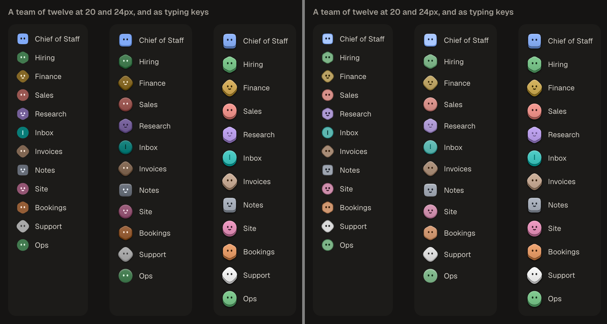
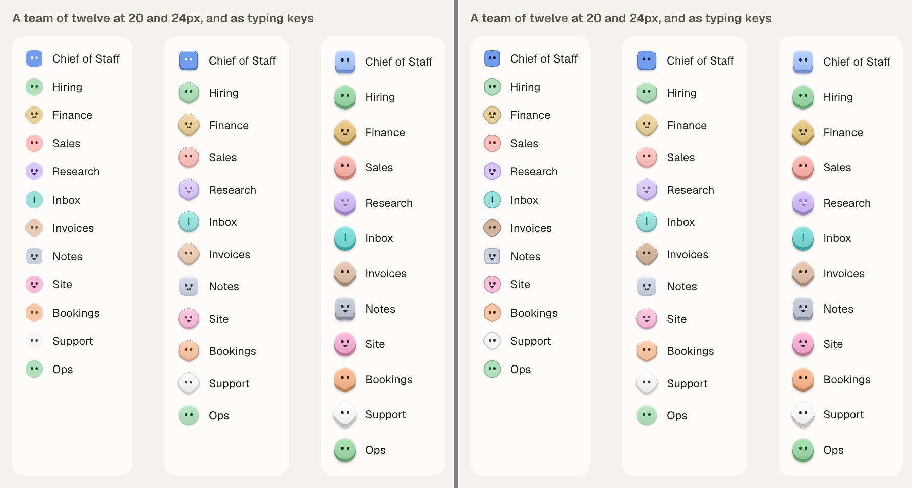
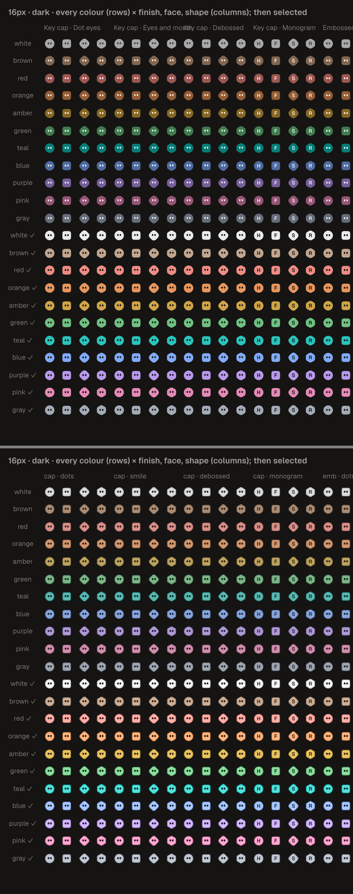
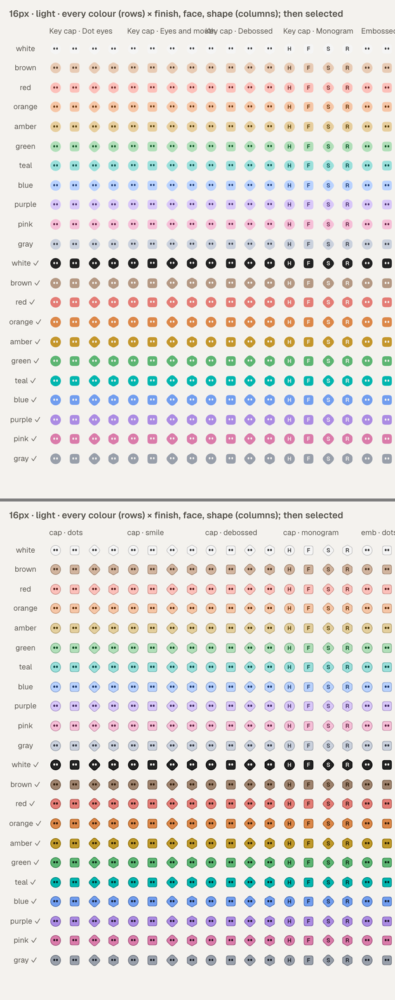
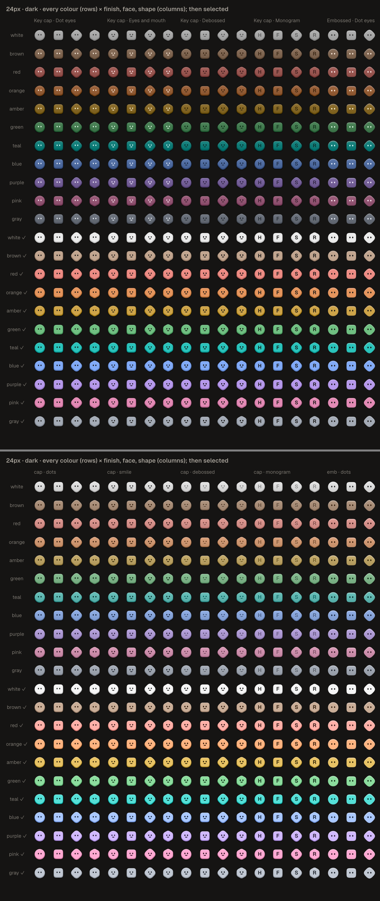
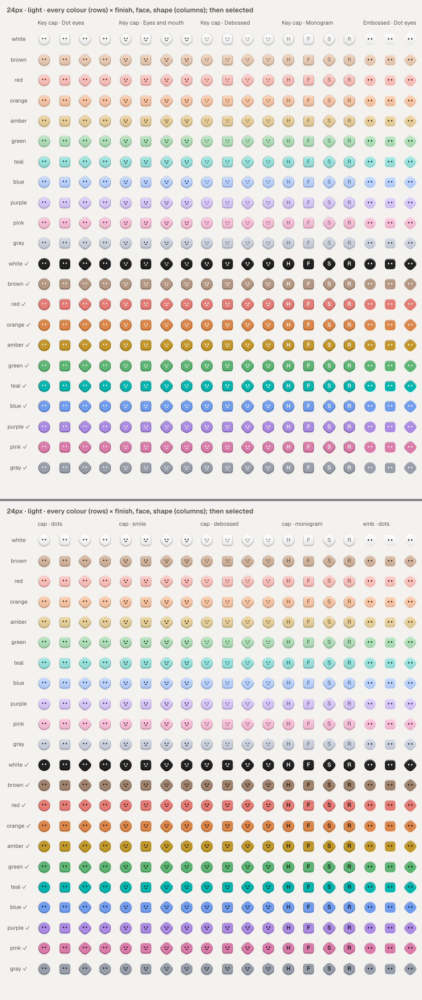
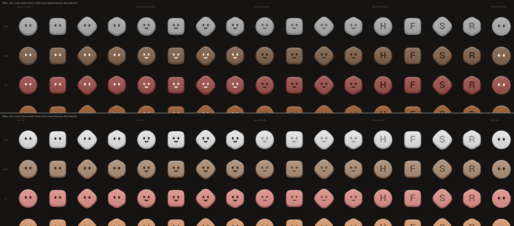
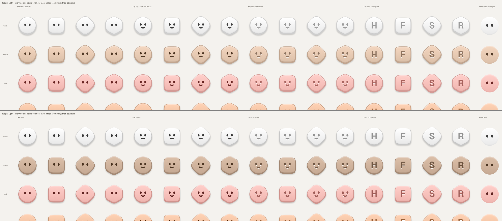
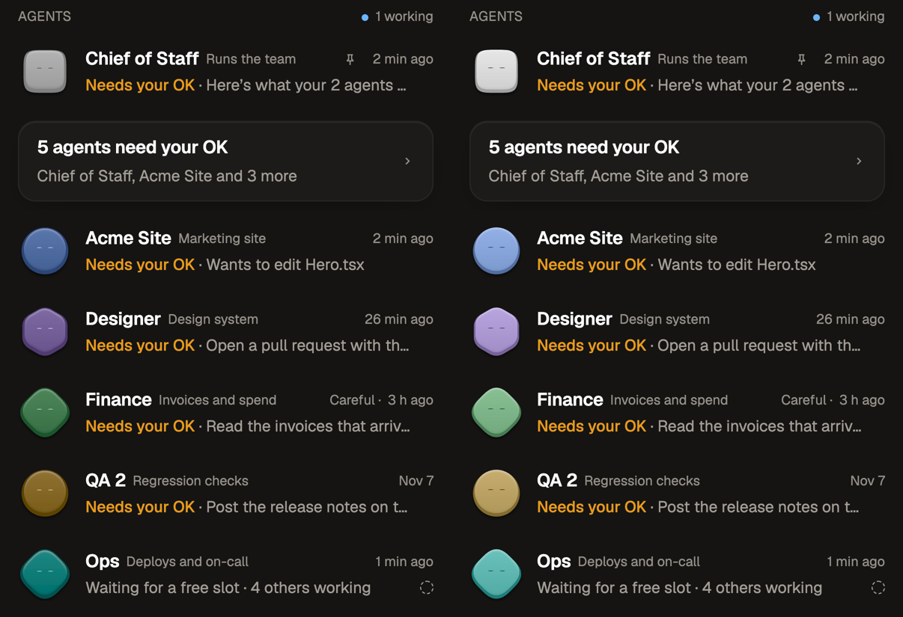

# Avatar review: ours against theirs

The owner asked for a deep look at competitors' agent avatars, with ours made "better and cleaner
than theirs". This note covers what they do, a strict critique of our full set, and what changed.
The system itself is described in [avatars.md](avatars.md).

## What the others do

Where a source was behind a login, the note says it was read about rather than seen.

| | Shape and colour | Face | Small sizes (16–24px) | Motion | Many agents in a list |
| --- | --- | --- | --- | --- | --- |
| **Reason Machines** (seen) | One flat hexagon. Each agent has its own hue, but the hues are not at equal lightness (brown sinks, yellow pops). The lead agent wears a star badge | Two vertical bars. They read as a pause glyph | Holds up well: flat, high contrast, one shape | None seen | Colour is the only cue, and nine hues on one shape is the limit. The eye colour flips between white and black by hue, which looks inconsistent |
| **OpenBot** (seen) | Furry 3D creatures in several shapes (diamond, rounded square, cloud), saturated and one colour each | Two small cream pill eyes | The fur turns to mush around 20px. The eyes survive; the silhouettes (a rotated square) blur | Dots over the head while it works (seen as a still) | Strong, because shape and colour both vary. Unread and busy badges sit on the face |
| **Claude** (read about) | A terracotta spark. Claude Code has a pixel crab | None, or a pixel crab | The spark reads at any size | The spark animates, and a glyph spinner runs while it works | One identity, so nothing tells agents apart |
| **ChatGPT** (read about) | The blossom, and custom GPT images (uploaded or generated) | None. Voice mode has an orb | GPT images are unreadable at 24px | The orb pulses | Visual noise, with no system |
| **Grok Bot** (read about: xAI's write-up) | Pick a shape and a colour | "Expressive eyes" | Clay and watercolour were rejected as too busy at sidebar size | Six states (idle, thinking, working, waiting, blocked, done) carried by the avatar itself | Shape × colour × eyes. This is the brief ours was written against |
| **Lindy** (seen) | One persona: a single-line face on a cream disc, warm gold | A line drawing | The squiggle goes below 20px | None seen | One agent only |
| **Manus, Devin** (seen) | A line-drawn hand; a dot cluster on a black square | None | Crisp | None | No per-agent identity |
| **Relevance AI** (seen) | Pixel-art human busts in white circles, with a green online dot | Human | The busts look alike when small | None | They imply a person, which is an honesty problem |

**What's worth taking:** shape *and* colour both carry identity (OpenBot). One face ink per theme,
so the set reads as one family (Reason's flipping eyes are the counter-example). Simple flat shapes
at small sizes (Reason). Status carried by the avatar's own motion rather than a pip on its face
(Grok Bot). No human faces and no textures.

**Where we already win:** a material (a key), which none of them has; equal-OKLCH colour;
four even shapes; eyes that blink and look around to say what the agent is doing, with nothing
ringing or covering the face; one spec for desk and phone.

## Our set, before: a strict critique

The contact sheets cover every shape × face × finish × colour, at rest and selected, at
16 / 20 / 24 / 32 / 64 / 128px, in both themes, plus a team of twelve at 20 and 24px beside the
typing keys. Generate them with `node scripts/avatar-strips.mjs --contact --prefix before-`
(harness `section=contact`, `section=list`).

1. **Dark theme was a different object.** The clay sat at L 0.53 with a white face: muddy on the
   warm charcoal. Red, orange, brown and pink pulled together, and "white" read as grey. Beside
   it, the typing key and the site's faces are pastel with a dark face. The sidebar and the
   working line showed two different products. *Biggest problem.*
2. **Light theme: no silhouette when flat.** At 16–20px a pale key on paper had no edge. White
   vanished into the page, leaving two eyes floating.
3. **Selected on light was illegible.** The canvas-coloured face on a mid-tone solid came to about
   2.4:1.
4. **At 16px the diamond was a blob.** The rounded rhombus (superellipse n = 3) next to the circle
   read as the same thing. The hexagon's soft corners were close.
5. **The eyes smeared.** At 16–22px the eye ovals landed on fractional pixels, so the two dots
   were soft and one could look heavier than the other.
6. **The key was a bezel.** The top was scaled 0.9 about a point near the centre, so the side
   showed all the way round, top included. A key's side shows below it (the site, our own
   typing key).
7. **Debossed on dark was invisible at 24px.** The well was L 0.27 on L 0.53 clay.
8. **Brown was pale orange in light** (ΔE ≈ 0.025), and **amber sat on orange** (≈ 0.034).
9. **Monogram below 24px:** an "I" reads as a bar or a pause glyph. Not changed: it is the letter
   someone chose, and a heavier weight would need a bold face on the phone.
10. **The embossed white on paper still has no edge** (no side, by design). Not changed: an edge
    would make it a key cap again.

What was already right: equal lightness per role, the four even shapes above 20px, eye spacing
and height matching the site's faces (38% and 62% across, 46% down), dot eyes as the default, and
the blink (140ms, rare, its own beat, none below 20px).

## What changed

All of it is in the shared spec (`packages/companion-protocol/src/avatar.ts`), drawn identically
on desk and phone. **No stored value changed.** Shapes, faces, finishes and colour keys are the
same keys, so every saved look stays valid and keeps its shape and hue family. Only the drawing
and the tones moved, which is what the spec's "store keys, never paths or colours" exists for.

| # | Change | Where |
| --- | --- | --- |
| 1 | **One object in both themes.** Dark is now a pastel key (clay L 0.72) with a dark face (L 0.26), a step below light's 0.86, like the site's faces and the typing key. Rim light 0.5, lip 0.55 | `AVATAR_ROLES`, `AVATAR_LIGHT` |
| 2 | **A dark face on a selected key** in both themes (`solidInk`, ≥ 4:1 on every colour). A dark solid (white selected on light, near black) keeps the canvas ink. Selected on dark is brighter and stronger (L 0.83, C 0.12), so it stays clearly apart from rest | `avatarPaint` |
| 3 | **A one-pixel edge on a flat key** (below 24px): the shape in the side tone, with the fill inset over it by 1 CSS px. White on paper has a silhouette now; the effect matches the site's 1px ring | `flatInset`, `FLAT_EDGE_PX` |
| 4 | **Optical size under 20px:** crisper silhouettes at the same area. Diamond n = 3.9 (from 3), hexagon corners 0.18 (from 0.32), squircle n = 5.4 (from 4.4), circle unchanged. From 20px up the drawing is byte-for-byte what it was | `SMALL_SHAPE_POINTS`, `shapePathAt` |
| 5 | **Pixel-snapped eyes on a flat key:** each eye's box starts and ends on a half CSS pixel (a device pixel on Retina), at least 2.5px wide, and the second eye mirrors the first about the middle. A lit key's eyes are untouched, since the face moves there | `eyesAt` |
| 6 | **A key, not a bezel:** the top is flush with the side along its upper edge (scale 0.93 about y 14.95), with a hair of side at the flanks and about 2 units below | `KEY.top` |
| 7 | **Debossed reads:** the well is L 0.47 dark / 0.55 light, at least 2:1 on the top | `AVATAR_ROLES.well` |
| 8 | **Colours kept apart:** brown is a step deeper than the hues (it reads as wood beside orange), and amber moves from 84° to 88°. Every pair at rest is ≥ 0.035 apart in OKLab, in both themes | `AVATAR_TONES` |

What wasn't changed: the motion, the blink, the faces' geometry above 24px, the typing key (it
was already the brand reference; dark avatars now match it), and the Rust side (it stores only
keys).

**Tests** (`avatar.test.ts`, "the optical size" and "the palette, against the page"):

- the small shapes keep their area and are pointier, never rounder
- the small faces stay clear of the crisper edges, with motion included
- the eyes snap, mirror, and are at least 2.2px
- the flat edge is 1px
- the top is flush
- a dark face on a pastel key in both themes
- a selected face at ≥ 4:1, every colour, both themes
- selected stays apart from rest
- every key has a silhouette on the warm canvases
- debossed is ≥ 2:1
- every colour pair stays apart

## Shots

| | |
| --- | --- |
| A team of twelve, dark (before \| after) |  |
| A team of twelve, light (before \| after) |  |
| 16px, dark (before over after) |  |
| 16px, light |  |
| 24px, dark |  |
| 24px, light |  |
| 128px, dark |  |
| 128px, light |  |
| Phone list, dark, qa:web (before \| after) |  |

The full sheets (every size, both themes, at 2x, and all sizes on one 1x sheet) come from
`node scripts/avatar-strips.mjs --contact [--prefix after-] --out <dir>`.

**Not checked:**

- a WKWebView build
- a device: qa:web is react-native-web. Its eyes show as dashes in the phone shots before and after, a qa:web artifact that is there with the old spec too (probably the blink layer under the web stand-in), not this change
- the 1x rendering of the snapped eyes by eye: they snap to half pixels, which is exact at 2x
