# Agent avatars

Each agent is a key cap in its own colour: one of four even shapes, raised like a key on a
keyboard, with a small face on its top. When it moves, it says what the agent is doing. The
brief was "smooth, clean, basic, a little personality, not cheesy", like Grok Bot's
pick-a-shape-and-a-face avatars.

- **Spec (one for both clients):** `packages/companion-protocol/src/avatar.ts`. It holds the
  shapes, faces, finishes, the key's construction, the palette (equal OKLCH per theme), the
  migration from the previous system and the motion.
- **Desk:** `src/components/agents/AgentAvatar.tsx` + `src/styles/features/agents-avatar.css`.
  This is the design system's second marked dynamic-SVG exception
  (`data-dynamic-svg="agent-avatar"`, `scripts/icons.mjs`: one `<svg` in the source, drawn as
  several layers).
- **Phone:** `AgentAvatar` in `mobile/src/components/agent.tsx`, drawn with react-native-svg 15.16
  (its native filters: offset, composite, blur, flood, merge) and moved with Reanimated.
- **Stored:** `avatar: { shape, face, finish? }` on the agent (additive, optional; a key cap
  writes no `finish`). Without one, both clients and the Mac (`AgentLook::default_for`) derive the
  same look from the id with FNV-1a. A test table in `avatar.test.ts` and `avatar_tests.rs` keeps
  the TS and Rust results identical.

## Why J won

The designer drew ten directions on one 32-unit grid with one equal-OKLCH palette
(`harness/avatar-directions/index.html?d=all`). The owner picked **J, Key caps**, and liked
**I, Embossed** next ("LOVING THE EMBOSSED ONES… the key cap ones are best").

- **Four even shapes, one construction.** Circle, squircle, diamond and hexagon are each a
  superellipse or a softened polygon scaled to the same area (a 13.9-unit circle's), so none reads
  bigger than its neighbour. The previous system had eight shapes of different visual weight; four
  even ones carry identity without a sticker-sheet sidebar.
- **Depth instead of loudness.** The key is a darker side, a lit top set up off it (0.9 scale,
  0.9 units high), a soft shadow and a rim light on the top edge. Identity comes from shape, hue
  and that bit of physicality, so the face can stay tiny and calm.
- **Flat below 24px.** At 16 and 18px the light and the side are mush, so the key is one flat
  shape with the face on it.
- **The face is a separate, small choice.** Dot eyes, eyes and a mouth, debossed (the features
  pressed into the top as wells with a light lip) or a monogram (the agent's initial). No props,
  no closed eyes.
- **Embossed is the same system with a different finish.** No side, no shadow; the whole shape is
  the top, pressed soft into the surface. It ships as `finish: embossed`, a stored option in the
  look picker on desk and phone; the key cap is the default.

### Default face: dot eyes

Every default (and every new agent) wears dot eyes. Two dots read at 16px, where a mouth is
dropped; they make the clearest motion when the face looks around; and twelve of them in a list
stay quiet. A mouth, a debossed face or a monogram is a personality someone picks.

The Chief of Staff defaults to the squircle, and no other agent gets the squircle by default
(defaults are spread over circle, diamond and hexagon).

## The system

**Construction** (`KEY`, `TOP_TRANSFORM`): shadow = the shape dropped 1.1 units, blurred 0.9,
black at 55% (dark) / 20% (light); side = the shape in the side tone; top = the shape at 0.9
about (16, 15.1), filled with a vertical gradient (±0.035 lightness) and lit by the rim filter
(light on the top edge, shade on the bottom, both inside the shape, depth 0.7). Embossed: the
gradient shape alone with a deeper rim (1.2 below 40px, 0.9 above). The filters are the
reference's primitive for primitive, on both clients.

**Faces** (`FACE_SPECS`): eyes are filled ovals, never under 2.2 device px across; a mouth is a
round-capped stroke at 6.25% of the avatar (never under 1.5 device px), dropped at 18px and
below. A debossed or monogram face is pressed in only on a lit, unselected key; otherwise it is
drawn on in the ink.

**Colour** (`avatarPaint`, `AVATAR_ROLES`): every hue at one lightness and chroma per role per
theme, converted to sRGB in the spec (chroma comes down for an out-of-gamut colour; lightness
never moves). The roles are the clay (top), side, ink, well, solid (selected) and the solid's
side. Gray and brown cap their chroma; white is a neutral a step lighter than gray with a dark
ink, and selected white on light is near black (the theme's strongest neutral). Tests hold every
hue to one lightness per role and the ink to 3.5:1 on its key in both themes. **Selected** (the
agent you're on) is the solid colour with the canvas colour as ink.

**Migration** (`LEGACY_SHAPES`, `LEGACY_FACES`, mirrored in `store.rs`): rounded and arch become
the squircle; pill, drop and cookie the circle; circle, squircle and hexagon stay. A face with a
mouth (calm, cheerful, curious, focused, sleepy, wink, determined, bright) becomes eyes and a
mouth; one without (quiet, content) dot eyes. It happens on read, the same way on every client
and the Mac, so nothing is rewritten on disk; anything saved from now on is in the new keys. An
old phone's old keys are accepted and saved as their nearest.

**Compatibility:** the Mac lists `agents.keycaps` in `welcome.features`; the phone shows its look
picker only to a Mac that does, so it never offers an older Mac a key it would refuse.

## Motion

In the owner's words: "slightly animated and move around in their shape like Grok Bot. Nothing
tacky. Use it to indicate thinking etc." A small state language (`AVATAR_MOTION`, `moodOf`):

| Mood | What moves | Timing |
| --- | --- | --- |
| Idle | The face drifts half a unit or so, and now and then glances aside (1.3 units) and back | 16s loop; each agent starts at its own point (`idlePhase`) |
| Working | The face looks left… up… back, holding each; the top's rim light breathes faintly (0 → 0.6 → 0) | 4.8s loop |
| Needs you | One key press (0.7 units), and the face looks out at you (up 0.35) and holds | 420ms, once |
| Done | One press and a small bounce (0.8 down, 0.25 up), then idle | 560ms, once, when working ends |
| Failed | One look down to the side (−1.1, +1), held | 700ms, once |

Rules:

- **The eyes never close and never blink.** Nothing rings, pulses or outlines an avatar, ever.
  Only transforms and the breathing light's opacity move (a test reads the stylesheet).
- **Below 24px only the face moves**, at 40% of the distance (`SMALL_MOTION`); no press, no light.
- **Moods come from what the rows already know:** needs you (a pending card or waiting), working,
  failed (a usage limit isn't a failure: it heals by itself), else idle. Needs you outranks
  working. Done is noticed by the avatar (working, then idle). Wired in the desk's sidebar rows,
  team view and chat header, and the phone's list rows, chat header and agent sheet. A phone row
  that is only the last thing it heard holds still.
- **Desk:** CSS keyframes only, no per-frame JS. Each moving part is its own layer (an HTML box
  over the SVG), so motion is a composited transform or opacity, never a repaint. The keyframes
  are the spec's, value for value (`agentAvatarMotion.test.ts`). One shared
  IntersectionObserver pauses avatars that are off-screen; a hidden window pauses all of them.
- **Phone:** Reanimated sequences built from the same keyframes, on the UI thread. Still in the
  background (AppState), on a screen that isn't showing (`useIsFocused`), and in the look picker.
- **Reduce Motion:** static, on both.

## On a key

While an agent works, the working line leads with the agent on a key (`AgentKey` on desk and
phone), in the marketing site's key language: a wide cap (24×18px, `TYPING_KEY`) with a lit top
edge, a darker side showing 3px under it, a hairline ring and a soft drop, faintly tinted with the
agent's hue (`typingKeyPaint`, equal OKLCH per theme like the rest of the palette). The avatar on
it is the solid (selected) one at 14px: you are looking at that agent, and the solid colour stays
clear of a near-white cap and a dark one alike (a test holds it to 1.8:1 against both ends of the
cap's gradient, every colour, both themes; the pastel clay on a white cap didn't, white least of
all).

While the line is live the key is typed on: a tap, a lighter tap, each with a small rebound, then
a rest (`TYPING_KEY.press`, 2.4s). Only the top moves: it presses into the side and at the bottom
of a tap covers it exactly, so the side reads as the key's depth, never as a lip above it.
Stalled ("No progress for 5 min") or finishing, it rests. Desk: CSS keyframes on one layer
(`agents-key-press`, checked against the spec by `agentKeyMotion.test.ts`), paused with the
window hidden. Phone: one clock on the UI thread read by the `keyDepth` worklet (checked as the
UI runtime runs it). Reduce Motion: still, on both. The steps' icon column is the key's width, so
the live line, its steps and the folded "Worked" line keep one grid.

## Sizes

Desk: `key` 14 (on the typing key), `xs` 16, `mini` 18, `row` 24 (sidebar), `field` 30 (24 beside a text field), `md` 40,
`hero` 46, `lg` 48, `xl` 96 (picker preview). Phone: 24, 28, 48 and 56.

## Changing it

- **Desk:** click the avatar beside the name in the agent editor. The look picker shows the 96px
  key, then Shape, Face, Finish and Color. The choices hold still.
- **Phone:** tap the avatar on the agent sheet: the same rows, saved as you tap (on a Mac listing
  `agents.keycaps`).
- **From chat:** "Give Hiring a hexagon with dot eyes". The Chief's `update_agent` takes `shape`,
  `face`, `finish` and `color` and applies them at once, with no card (a look isn't a setting).
  The reply says "Updated Hiring: now a hexagon with dot eyes." An old word ("pill") lands on its
  nearest shape.

## Shots

From `scripts/avatar-strips.mjs` (harness: `harness-avatars.html` and the `agents-avatars`
scenario). Strips are the real CSS animation paused at each frame's time.

| | |
| --- | --- |
| Sidebar of 12, dark |  |
| Sidebar of 12, light | 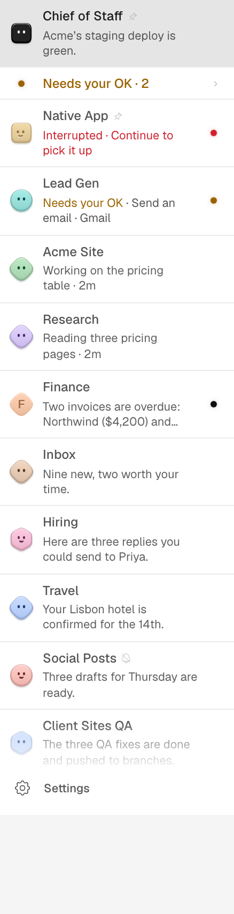 |
| Every shape × face, both finishes | 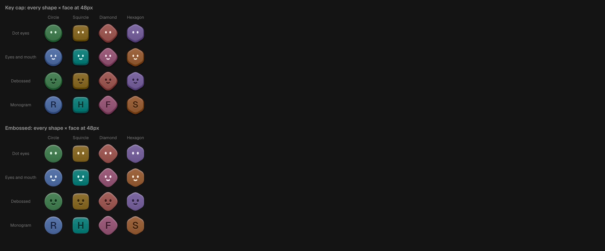 |
| Sizes 16 → 96 | 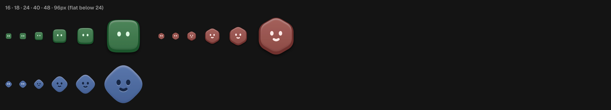 |
| Colours: rest, selected, embossed | 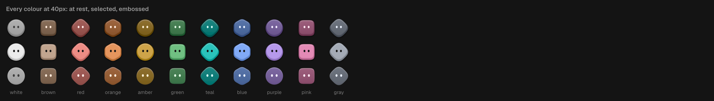 |
| Idle, 96px | 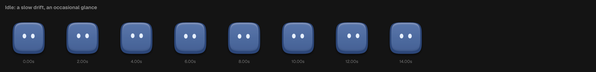 |
| Working, 96px | 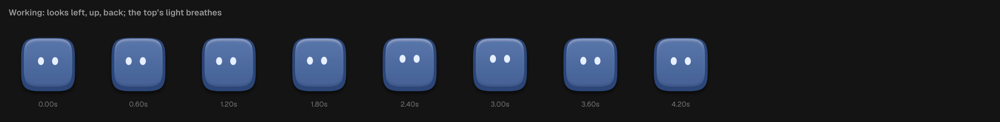 |
| Needs you, 96px | 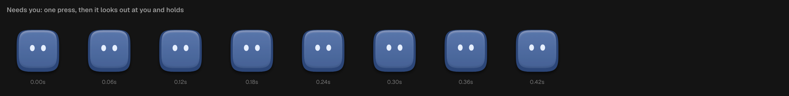 |
| Done, 96px | 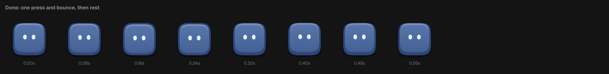 |
| Failed, 96px | 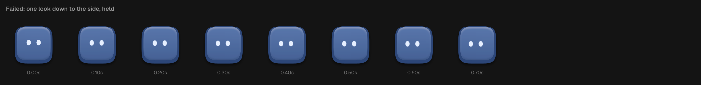 |
| Phone list (qa:web, react-native-web) | 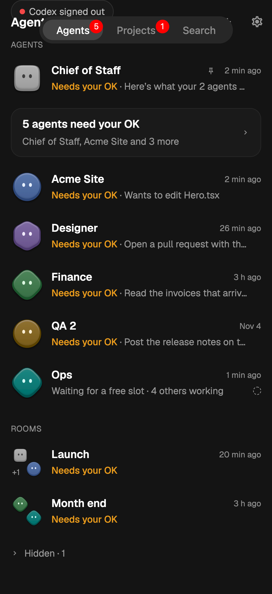 |
| Phone look picker | 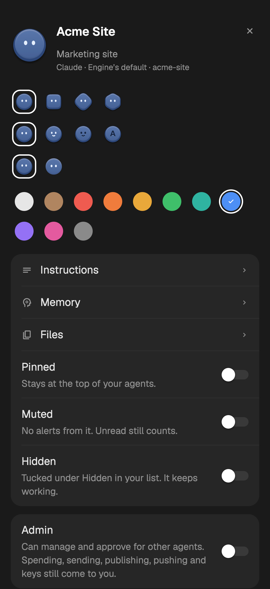 |
| Direction J as drawn | 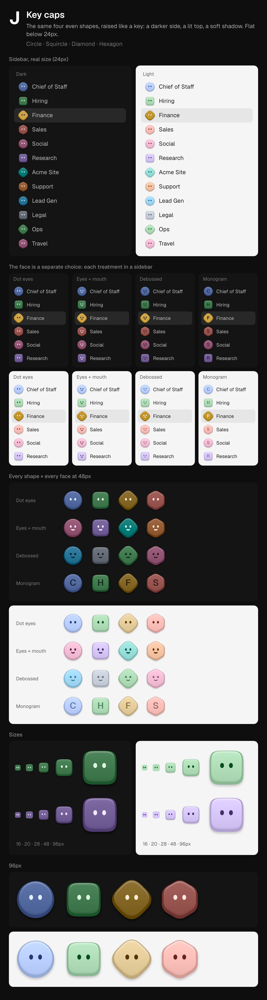 |

## Checked, and not checked

**Checked:** the shots above (desk, Chrome); the spec tests (edge clearance with the furthest
motion, equal lightness, contrast, migration, parity tables), the Rust parity and migration
tests, the CSS-vs-spec motion test, and the suites listed in the commit.

**Not checked:** a real WKWebView build (SVG filters and composited CSS transforms in WebKit), an
iOS or Android device (react-native-svg's native filters, Reanimated timing, `useIsFocused`
pausing), the phone screens by eye (qa:web is react-native-web), and the motion's feel at
speed rather than as frames.
